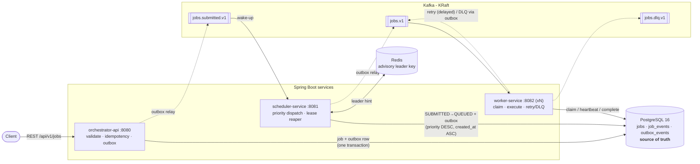
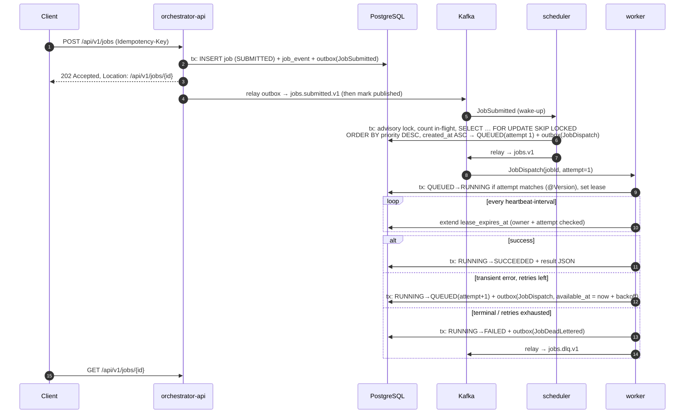
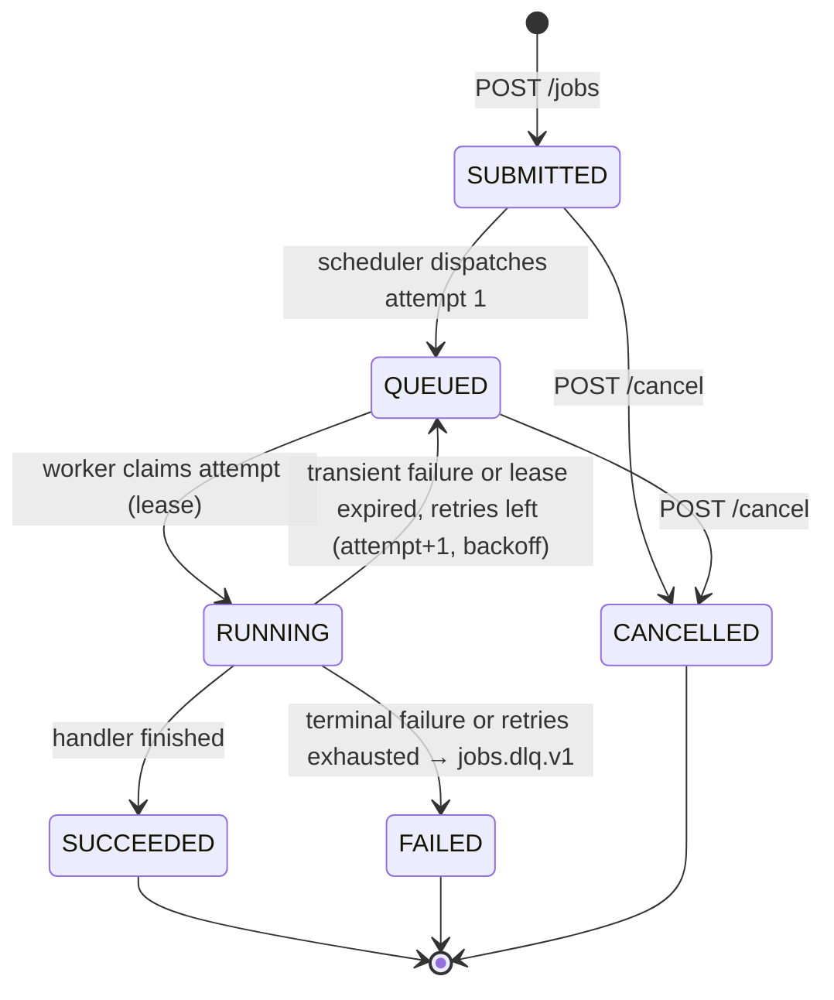

# Task Orchestrator Platform

A distributed job execution platform built with **Java 21, Spring Boot 3.5, PostgreSQL 16, Kafka (KRaft) and Redis**.
A REST API accepts jobs. A scheduler releases them in priority order from a database-backed queue. Horizontally
scalable workers run a fixed **allowlist of bounded task types**. Transient failures are retried with bounded
exponential backoff. Terminal failures end in `FAILED` and are published to a dead-letter topic. Crashed workers
are detected through lease expiry, and their jobs are re-run.

The platform never runs user-supplied code, shell commands or URLs. The only things it executes are three built-in
handlers with hard bounds and a timeout.

---

## Contents

- [Architecture](#architecture)
- [Job lifecycle](#job-lifecycle)
- [Reliability design](#reliability-design)
- [Supported job types](#supported-job-types)
- [Quick start](#quick-start)
- [API](#api)
- [Configuration](#configuration)
- [Observability](#observability)
- [Tests and CI](#tests-and-ci)
- [Evidence](#evidence)
- [Troubleshooting](#troubleshooting)
- [Limitations](#limitations)
- [Future enhancements](#future-enhancements)

---

## Architecture



| Component | Responsibility |
|---|---|
| `common-contracts` | Framework-free shared code: `JobType`, `JobStatus`, the **single state machine**, strict payload rules, the backoff policy and versioned (v1) Kafka event records. |
| `job-core` | Shared persistence library. It holds the Flyway schema, JPA entities (with `@Version` optimistic locking), `JobLifecycleService` (the *only* code that changes a job's status), the transactional outbox writer and the outbox relay, plus the Kafka error handling and topic definitions. |
| `orchestrator-api` | Validates requests, applies `Idempotency-Key`, persists the job and outbox row in one transaction, and serves status, list, history and cancel. Also serves OpenAPI and Swagger UI. |
| `scheduler-service` | Moves `SUBMITTED` jobs to `QUEUED` in strict priority order, capped by `max-in-flight`. Runs the **lease reaper** that recovers jobs from crashed workers. Uses Redis only as an advisory leader hint. |
| `worker-service` | Consumes `jobs.v1`, claims an attempt transactionally, runs the handler on a bounded pool with a timeout, renews the lease while running, and records success, retry or failure through the lifecycle service. |

All three services share one PostgreSQL schema (owned by `job-core` migrations). Kafka messages carry only IDs and
attempt numbers. **The database row, not the event, is authoritative.**

### Happy path and retry, end to end



---

## Job lifecycle



The transitions are defined once, in
[`JobStateMachine`](common-contracts/src/main/java/com/taskorchestrator/contracts/JobStateMachine.java), and
enforced only by
[`JobLifecycleService`](job-core/src/main/java/com/taskorchestrator/core/lifecycle/JobLifecycleService.java). Each
transition writes an audit row to `job_events`, which `GET /api/v1/jobs/{id}/events` exposes. Any other change is
rejected with `InvalidJobTransitionException`, which the API maps to HTTP 409.

`attempt` counts executions. `maxRetries` (0–5) is the number of retries after the first attempt, so a job runs at
most `maxRetries + 1` times.

---

## Reliability design

**Transactional outbox and at-least-once delivery.** Every Kafka message is first written to `outbox_events` in the
same transaction as the state change it announces. If the transaction rolls back, no message exists. Each service
runs an `OutboxPublisher` that claims due rows with `FOR UPDATE SKIP LOCKED`, sends them with `acks=all`, waits for
the broker acknowledgement, and only then marks them `published_at`. A crash between the acknowledgement and the
commit causes a re-send, so delivery is **at-least-once** and every consumer is idempotent. A failed send is recorded
on the row (`publish_attempts`, `last_error`) and retried with exponential backoff capped at 60s. This covers
DLQ events too, so **a DLQ publish failure is retried and visible in the database**. Any service instance may relay
any row, which is why per-service `outbox_published` counters differ.

**Duplicate-safe consumers.**
- The scheduler treats `JobSubmitted` purely as a wake-up signal. Dispatch is driven by the database, so duplicate
  events and restarts cannot queue an attempt twice: the `SUBMITTED→QUEUED` transition happens once, under row
  locks.
- A worker runs a delivery only if the job is still `QUEUED` *with the same attempt number*. The claim is guarded by
  `@Version`, so if several workers receive the same message concurrently, exactly one wins. The others, along with
  stale and post-completion deliveries, are acknowledged and counted in `orchestrator_worker_deliveries_skipped`.

**Priority scheduling and Kafka ordering.** Kafka only orders messages within a partition (messages are keyed by
`jobId`), so it can't provide global priority. Priority is therefore enforced *before* Kafka. The scheduler keeps
jobs in the database and dispatches them with
`ORDER BY priority DESC, created_at ASC, id ASC … FOR UPDATE SKIP LOCKED`, and never allows more than
`scheduler.max-in-flight` jobs in `QUEUED + RUNNING`. Because the backlog handed to Kafka is bounded, a newly
submitted priority-5 job overtakes older priority-1 jobs still waiting in the database
([`PriorityDispatchIT`](scheduler-service/src/test/java/com/taskorchestrator/scheduler/PriorityDispatchIT.java)
verifies the exact order). Retries are re-dispatched directly with a delay and are not re-ranked.

**Multiple schedulers.** Every dispatch cycle runs inside a transaction holding a Postgres advisory lock
(`pg_try_advisory_xact_lock`), so only one cycle runs cluster-wide at a time and the capacity count stays exact. On
top of that, Redis holds an advisory leader key (`SET NX PX` plus an owner-checked renew script, released on
shutdown) so that non-leaders don't keep scanning. **Redis is not needed for correctness.** If it is unreachable,
the coordinator logs a warning and falls back to database locking alone.

**Retries and backoff.** The delay is `initial-delay × multiplier^(attempt-1)`, capped at `max-delay`. With the
defaults (1s, ×2, 8s) the delays are 1s, 2s, 4s, 8s, 8s. A retry is a `RUNNING→QUEUED` transition plus an outbox
row whose `available_at` is in the future, so no thread sleeps and nothing polls tightly.

| Failure | Classified as | Result |
|---|---|---|
| Timeout (`worker.task-timeout`), interrupted or cancelled task, saturated pool, unexpected handler exception, `failTransientlyTimes` | transient | retry while `attempt < maxRetries + 1`, then `FAILED` + DLQ |
| Invalid payload (re-validated by the worker), unknown type, out-of-range input, `failPermanently` | permanent | `FAILED` + DLQ immediately |
| Worker crash or missed heartbeats (lease expired) | transient | the lease reaper re-queues the job with backoff, or `FAILED` + DLQ |

**Dead-letter events** (`JobDeadLettered` on `jobs.dlq.v1`) contain the job ID, type, attempt counts, a reason (one
line, at most 500 characters) and a timestamp. They never contain the payload or a stack trace.

**Poison messages.** A Kafka record that can't be parsed, or that uses an unsupported `schemaVersion`, raises a
`PoisonMessageException`. The shared `DefaultErrorHandler` then forwards the raw record to `jobs.dlq.v1` with
Spring's `kafka_dlt-*` diagnostic headers and commits the offset, so one bad record can't block a partition. Other
unexpected listener errors are retried twice, one second apart, before being dead-lettered the same way. DLQ
consumers can tell the two kinds apart by the `eventType` header (sanitised job failure) versus the
`kafka_dlt-exception-fqcn` header (poison record).

**Crash recovery with leases.** A claim sets `lease_owner` and `lease_expires_at` (default 30s). While a task runs,
a heartbeat extends the lease every 10s, checking owner, status and attempt. Every 5s, the scheduler's
`LeaseReaper` selects `RUNNING` jobs whose lease has expired (`SKIP LOCKED`) and handles each as a transient failure
of that attempt. If the original worker turns out to be alive and finishes later, its completion fails the
ownership/`@Version` check and the stale result is discarded. If a heartbeat finds the lease already gone, the
worker interrupts the task.

**Exactly-once is not guaranteed.** Execution is at-least-once. A worker can finish a handler and then crash before
recording the result, and the attempt will run again. Handlers must therefore be idempotent and free of side
effects. The built-in ones are pure computations or sleeps. The platform does guarantee that **at most one
execution per attempt is ever recorded as the outcome, and a job records exactly one `SUCCEEDED` transition.**

**Graceful shutdown and bounded resources.**
- On SIGTERM, Tomcat drains requests, listener containers finish the record in progress, the scheduler releases
  its Redis leader key, and the task pool waits up to the task timeout. In a local test, a running 5s job
  completed during `docker compose stop`.
- Resources are bounded throughout: consumer threads (`worker.concurrency`), task pool and queue, `max.poll.records`,
  outbox and reaper batch sizes, in-flight capacity and Hikari pool size.

---

## Supported job types

| Type | Payload | Bounds | Result |
|---|---|---|---|
| `SLEEP` | `{"durationMs": 1500}` | 0–15000 ms, interruptible | `{"sleptMs": 1500}` |
| `FIBONACCI` | `{"n": 30}` | 0 ≤ n ≤ 40, iterative | `{"n": 30, "value": 832040}` |
| `DATA_SUMMARY` | `{"values": [1, 2.5, 3]}` | 1–1000 finite numbers | `count, sum, min, max, mean, median, stdDev` (population) |

Unknown payload fields are rejected with 400, which blocks attempts to smuggle `command` or `url` fields. Any
payload may also include two **bounded fault-injection fields** for demos and tests:

- `"failTransientlyTimes": N` (0–10): attempts 1..N throw a retryable error.
- `"failPermanently": true`: a non-retryable error on the first attempt.

There were no legacy job types or fields to map; this repository started empty.

---

## Quick start

**Requirements:**
- Docker Desktop or Docker Engine with Compose v2 (about 4 GB RAM free).
- Python 3.9+ for the scripts.
- JDK 21 and Maven 3.9+ only to build and test outside Docker.

```bash
cp .env.example .env              # optional: every value has a local default
docker compose up --build -d --wait
docker compose ps
```

```
SERVICE             STATUS                    PORTS
kafka               Up 38 seconds (healthy)   127.0.0.1:9094->9094/tcp
orchestrator-api    Up 32 seconds (healthy)   0.0.0.0:8080->8080/tcp
postgres            Up 38 seconds (healthy)   127.0.0.1:5432->5432/tcp
redis               Up 38 seconds (healthy)   127.0.0.1:6379->6379/tcp
scheduler-service   Up 26 seconds (healthy)   0.0.0.0:8081->8081/tcp
worker-service      Up 26 seconds (healthy)   0.0.0.0:8082->8082/tcp
```

The infrastructure containers have healthchecks, and the services start in dependency order: Postgres, Kafka and
Redis first, then the API (which applies the migrations), then the scheduler and workers. Each app's healthcheck is
`/actuator/health/readiness`.

```bash
python3 scripts/smoke_test.py             # acceptance test: 32 checks, about 25 s
python3 scripts/crash_recovery_demo.py    # SIGKILLs the worker mid-job, shows lease recovery (about 60 s)

docker compose logs -f worker-service                                     # structured JSON (ECS) logs
docker compose logs worker-service --no-log-prefix | grep '"jobId":"<id>"'
docker compose up -d --scale worker-service=3                             # host ports 8082-8084
docker compose --profile observability up -d                              # Prometheus on http://localhost:9090

docker compose down          # stop (keeps the Postgres volume)
docker compose down -v       # stop and delete all data
```

- Swagger UI: <http://localhost:8080/swagger-ui.html>
- OpenAPI JSON: <http://localhost:8080/v3/api-docs>

### Run the services outside Docker

```bash
docker compose up -d postgres kafka redis       # Kafka is exposed on localhost:9094 for host processes
mvn -q install -DskipTests                      # installs the shared modules into ~/.m2
DB_PASSWORD=change-me-local-only mvn -pl orchestrator-api spring-boot:run
# likewise for scheduler-service and worker-service, in separate terminals (stop their containers first)
```

---

## API

Base path `/api/v1/jobs`. Every error uses one RFC 9457 problem format and never includes a stack trace.

| Method and path | Purpose | Success | Errors |
|---|---|---|---|
| `POST /api/v1/jobs` | Submit a job (`Idempotency-Key` header optional) | `202` + `Location` | `400`, `409` (key reused with a different body) |
| `GET /api/v1/jobs/{id}` | Status, result, timestamps, attempts | `200` | `400` (not a UUID), `404` |
| `GET /api/v1/jobs?status=&type=&page=&size=` | Page through jobs, newest first with `id` as tie-break | `200` | `400` (bad filter, `size` > 100, `page` < 0) |
| `GET /api/v1/jobs/{id}/events` | Audit trail of transitions | `200` | `404` |
| `POST /api/v1/jobs/{id}/cancel` | Cancel while `SUBMITTED`/`QUEUED` | `200` | `404`, `409` (running or finished) |
| `GET /actuator/health`, `/actuator/prometheus` | Health and metrics (all three services) | `200` | |

### Submit a job

```bash
curl -i -X POST localhost:8080/api/v1/jobs \
  -H 'Content-Type: application/json' \
  -H 'Idempotency-Key: order-1234' \
  -d '{"title":"fib-30","type":"FIBONACCI","payload":{"n":30},"priority":5,"maxRetries":3}'
```

```http
HTTP/1.1 202
Location: /api/v1/jobs/c3eac529-7e0b-42bb-9ce1-aa71dc46e69e
Idempotent-Replayed: false
Content-Type: application/json

{"id":"c3eac529-7e0b-42bb-9ce1-aa71dc46e69e","title":"fib-30","type":"FIBONACCI","status":"SUBMITTED",
 "priority":5,"maxRetries":3,"attempt":0,"estimatedRuntimeMs":10,"payload":{"n":30},"result":null,
 "lastError":null,"createdAt":"2026-11-21T20:04:16.892983845Z","updatedAt":"2026-11-21T20:04:16.892983845Z",
 "startedAt":null,"completedAt":null}
```

`priority` is 1–5 (default 3, higher runs first). `maxRetries` is 0–5 (default 3). `title` is 1–200 characters.
Unknown top-level fields are rejected.

**How `Idempotency-Key` behaves.** The key is optional and must be 1–128 characters from `[A-Za-z0-9._:-]`.

| Situation | Response |
|---|---|
| First request with a key | Creates the job. The key and a SHA-256 fingerprint of the canonicalised request (keys sorted, defaults applied) are stored under a unique constraint. |
| Same key, same body | `202` with the **original** job and `Idempotent-Replayed: true`. Nothing new is created. |
| Same key, different body | `409 IDEMPOTENCY_KEY_REUSED` |
| Concurrent first requests with one key | The unique index decides the winner. The losers re-read the job and replay it (covered by a test with 6 parallel requests). |
| No key | Every request creates a new job. |

Keys never expire. That is a documented limitation.

### Get a job and its history

```bash
curl -s localhost:8080/api/v1/jobs/c3eac529-7e0b-42bb-9ce1-aa71dc46e69e
```

```json
{"id":"c3eac529-7e0b-42bb-9ce1-aa71dc46e69e","title":"fib-30","type":"FIBONACCI","status":"SUCCEEDED",
 "priority":5,"maxRetries":3,"attempt":1,"estimatedRuntimeMs":10,"payload":{"n":30},
 "result":{"n":30,"value":832040},"lastError":null,"createdAt":"2026-11-21T20:04:16.892984Z",
 "updatedAt":"2026-11-21T20:04:17.350645Z","startedAt":"2026-11-21T20:04:17.335175Z",
 "completedAt":"2026-11-21T20:04:17.351380Z"}
```

```bash
curl -s localhost:8080/api/v1/jobs/<id>/events
```

```json
[{"fromStatus":null,"toStatus":"SUBMITTED","attempt":0,"actor":"api","detail":"accepted"},
 {"fromStatus":"SUBMITTED","toStatus":"QUEUED","attempt":1,"actor":"scheduler","detail":"dispatched attempt 1"},
 {"fromStatus":"QUEUED","toStatus":"RUNNING","attempt":1,"actor":"2b3f0cab607f-c8815b02","detail":"claimed by 2b3f0cab607f-c8815b02"},
 {"fromStatus":"RUNNING","toStatus":"SUCCEEDED","attempt":1,"actor":"2b3f0cab607f-c8815b02","detail":"succeeded on attempt 1"}]
```

`occurredAt` timestamps are omitted above for brevity.

### List, cancel and errors

```bash
curl -s 'localhost:8080/api/v1/jobs?status=FAILED&type=DATA_SUMMARY&page=0&size=20'
# {"content":[{...job...}],"page":0,"size":20,"totalElements":6,"totalPages":1}

curl -s -X POST localhost:8080/api/v1/jobs/<id>/cancel
# 200 with status CANCELLED, or 409 if the job is already RUNNING or finished
```

```json
{"type":"https://task-orchestrator.local/problems/invalid-payload","title":"Bad Request","status":400,
 "detail":"Job payload is invalid for its type","instance":"/api/v1/jobs","code":"INVALID_PAYLOAD",
 "errors":["payload.durationMs must be between 0 and 15000"]}

{"type":"https://task-orchestrator.local/problems/validation-failed","title":"Bad Request","status":400,
 "detail":"Request validation failed","instance":"/api/v1/jobs","code":"VALIDATION_FAILED",
 "errors":["priority must be less than or equal to 5","title must not be blank"]}

{"type":"https://task-orchestrator.local/problems/job-not-found","title":"Not Found","status":404,
 "detail":"Job 00000000-0000-0000-0000-000000000000 not found","code":"JOB_NOT_FOUND", "...": "..."}
```

The error codes are `VALIDATION_FAILED`, `INVALID_PAYLOAD`, `MALFORMED_REQUEST`, `INVALID_PARAMETER` (400),
`JOB_NOT_FOUND` (404), `INVALID_STATE_TRANSITION`, `IDEMPOTENCY_KEY_REUSED`, `CONCURRENT_UPDATE` (409) and
`INTERNAL_ERROR` (500, generic message only).

---

## Configuration

All settings are environment variables. Shared defaults live in
[`orchestrator-defaults.yml`](job-core/src/main/resources/orchestrator-defaults.yml), and Compose reads overrides
from `.env` ([`.env.example`](.env.example)). The only credentials are local development placeholders, and `.env`
is gitignored.

| Variable | Default | Meaning |
|---|---|---|
| `DB_URL` / `DB_USERNAME` / `DB_PASSWORD` | `jdbc:postgresql://localhost:5432/orchestrator` | Database connection |
| `KAFKA_BOOTSTRAP_SERVERS` | `localhost:9094` | Kafka brokers |
| `KAFKA_TOPIC_PARTITIONS` | `6` | Partitions per topic. Caps parallel consumers across all workers. |
| `REDIS_HOST` / `REDIS_PORT` | `localhost` / `6379` | Scheduler's advisory leader key |
| `SCHEDULER_MAX_IN_FLIGHT` | `8` | Cap on `QUEUED + RUNNING` jobs |
| `SCHEDULER_DISPATCH_INTERVAL_MS` | `1000` | Fallback polling cycle. Submissions also trigger dispatch immediately. |
| `SCHEDULER_LEASE_REAPER_INTERVAL_MS` | `5000` | Expired-lease scan interval |
| `WORKER_CONCURRENCY` | `2` | Listener threads per worker = concurrent tasks |
| `WORKER_TASK_TIMEOUT` | `20s` | Hard per-attempt timeout (transient failure) |
| `WORKER_LEASE_DURATION` / `WORKER_HEARTBEAT_INTERVAL` | `30s` / `10s` | Claim lease and renewal period |
| `ORCHESTRATOR_RETRY_INITIAL_DELAY` / `_MULTIPLIER` / `_MAX_DELAY` | `1s` / `2.0` / `8s` | Retry backoff |
| `ORCHESTRATOR_OUTBOX_POLL_INTERVAL_MS` / `_BATCH_SIZE` | `500` / `50` | Outbox relay |
| `LOG_FORMAT` (Compose) | `ecs` | Structured console logs: `ecs`, `logstash` or `gelf` |
| `HEALTH_SHOW_DETAILS` | `never` (app), `always` (Compose) | Actuator health details |

---

## Observability

- **Health:** `/actuator/health`, `/actuator/health/liveness` and `/actuator/health/readiness` on ports
  8080, 8081 and 8082.
- **Metrics:** `/actuator/prometheus`, tagged with `application`. Optional Prometheus via
  `--profile observability` ([config](infra/prometheus/prometheus.yml)).

  | Metric | Meaning |
  |---|---|
  | `orchestrator_job_transitions_total{from,to}` | Every status transition |
  | `orchestrator_jobs{status}` (scheduler) | Current job count per status |
  | `orchestrator_scheduler_dispatched_total`, `orchestrator_scheduler_leases_reclaimed_total` | Dispatches and recovered leases |
  | `orchestrator_worker_execution_seconds{type,outcome}` | Execution time by type and outcome |
  | `orchestrator_worker_deliveries_skipped_total` | Duplicate or stale deliveries ignored |
  | `orchestrator_outbox_pending`, `orchestrator_outbox_published_total`, `orchestrator_outbox_publish_failures_total` | Outbox relay |

- **Logs:** Spring Boot structured logging (ECS JSON in Compose). `jobId` is set in the MDC by the listeners, the
  scheduler and the outbox relay, so every related line carries a top-level `"jobId"` field. Outside Compose, the
  plain console pattern includes `[jobId=…]`.

---

## Tests and CI

```bash
mvn verify     # Checkstyle + unit tests (Surefire) + Testcontainers integration tests (Failsafe, *IT)
mvn test       # unit and web-slice tests only; no Docker needed
```

Integration tests start throwaway `postgres:16`, `confluentinc/cp-kafka:7.6.1` (KRaft) and `redis:7` containers.
Without Docker they are **skipped, not failed** (`@Testcontainers(disabledWithoutDocker = true)`).

Last local `mvn clean verify` run (JDK 21.0.13, Maven 3.9.14, Docker 29.1.3): **BUILD SUCCESS, 71 unit tests and
31 integration tests, 0 failures, 0 skipped**.

| Module | Unit / slice tests | Integration tests (real Postgres + Kafka) |
|---|---|---|
| common-contracts (34) | State machine (all transitions), payload bounds and allowlist, backoff, error sanitising | |
| job-core (1 + 8) | Outbox publish failure recorded, then retried with backoff | Flyway migration; atomic job + audit + outbox and rollback; full retry lifecycle; DLQ outbox; cancel rules; **8 concurrent claims → exactly 1 winner**; outbox → Kafka with headers |
| orchestrator-api (17 + 7) | WebMvc contract tests: 202/Location, 400 (validation, malformed JSON, unknown type or field, payload rules, bad UUID, paging), 404, 409, 405, 500 with no leaks; request fingerprinting | HTTP end to end; nothing persisted on 400; idempotent replay and 409; **6 concurrent same-key requests → 1 job**; deterministic pagination and filters; cancel then 409; health, Prometheus and OpenAPI |
| scheduler-service (2 + 6) | Redis leader acquire, renew and lose; DB-only fallback when Redis is down | **Exact priority order under bounded capacity**; repeated cycles never re-queue; lease expiry → retry → FAILED + DLQ; live lease untouched; **duplicate submission events → one dispatch**; poison record → DLQ without blocking |
| worker-service (17 + 10) | Handler results (F(0..40), statistics, sleep), allowlist registry, timeout interrupts, fault injection, payload re-validation | FIBONACCI and DATA_SUMMARY results; transient → retry → success (exact history); exhausted → FAILED + sanitised DLQ record; permanent → no retry; timeout; **5+1 duplicate deliveries → 1 execution**; heartbeat keeps the lease alive; cancelled job never runs; poison → DLQ |

**CI** ([`.github/workflows/ci.yml`](.github/workflows/ci.yml)) has two jobs, with `contents: read` permission only:
1. JDK 21 `mvn -B verify`, which includes Checkstyle and the Testcontainers suites on the Docker-enabled Ubuntu
   runner.
2. `docker compose up --build --wait` followed by `scripts/smoke_test.py`.

The workflow has not run on GitHub yet; it was validated locally only (YAML parses, and the same commands pass).

---

## Evidence

[`docs/evidence/`](docs/evidence/) contains text transcripts (not screenshots) captured from the local stack:

- [`smoke-test-output.txt`](docs/evidence/smoke-test-output.txt): 32/32 acceptance checks. 12 mixed jobs whose
  results match independently computed values, a transient retry with 1s and 2s backoff, exhausted and permanent
  failures on the DLQ, an idempotent replay and 409, error contracts, pagination, and duplicate dispatch events
  ignored.
- [`crash-recovery-output.txt`](docs/evidence/crash-recovery-output.txt): a worker SIGKILLed while `RUNNING`. The
  lease reaper re-queued the job 34 s after its claim (30 s lease + up to 5 s reaper scan), and a new worker instance completed
  attempt 2.

Other observations from local runs. Each was a single run on a laptop and **is not a benchmark**:
- 15 smoke-test jobs reached terminal states in 3–9 s.
- 12 × 2 s SLEEP jobs took 10.4 s with 3 workers on 3 partitions, and 7.8 s after raising partitions to 6. The
  remaining gap is caused by jobId-hash skew across partitions.

---

## Troubleshooting

| Symptom | Fix |
|---|---|
| `port is already allocated` | Change `API_PORT`, `POSTGRES_HOST_PORT` and the other ports in `.env`. |
| Worker health not on 8082 | Workers publish into the 8082–8084 range so they can scale. Run `docker compose port worker-service 8082`. |
| Jobs stay `SUBMITTED` | Check `docker compose logs scheduler-service`. Is it healthy, and is `orchestrator_jobs{status="QUEUED"}` at `SCHEDULER_MAX_IN_FLIGHT`? |
| Jobs stay `QUEUED` | Check that a worker is healthy (`docker compose ps`) and `orchestrator_outbox_pending` on any service. |
| A crashed worker's job stays `RUNNING` | Expected until the lease expires (30 s) plus one reaper scan (5 s). |
| `Cannot connect to the Docker daemon` | Start Docker Desktop. Without Docker, `mvn test` still runs the unit tests, and the integration tests are skipped. |
| Integration tests fail on Docker 29+ | Testcontainers must be 1.21.4 or newer (managed by Spring Boot 3.5.16 here). |
| Reset everything | `docker compose down -v && docker compose up --build -d --wait` |

---

## Project layout

```
pom.xml                      Maven multi-module build (Spring Boot 3.5.16 parent, Java 21)
common-contracts/            enums, state machine, payload rules, backoff, Kafka event records
job-core/                    Flyway migrations (src/main/resources/db/migration), JPA, lifecycle, outbox
orchestrator-api/            REST API, idempotency, error handling, OpenAPI
scheduler-service/           priority dispatcher, lease reaper, Redis coordinator
worker-service/              task handlers, runner (timeout), execution service (claim/heartbeat/complete)
infra/prometheus/            Prometheus scrape config (optional profile)
scripts/                     smoke_test.py (acceptance), crash_recovery_demo.py
config/checkstyle/           lint rules enforced in the validate phase
compose.yaml, Dockerfile     local stack; one Dockerfile builds all services (--build-arg MODULE)
.github/workflows/ci.yml     CI
docs/evidence/               captured run transcripts
```

---

## Limitations

- **At-least-once execution.** Handlers can run more than once per attempt after a crash. Only the recorded outcome
  is deduplicated.
- **Global priority applies only to the first dispatch.** Retries are re-dispatched with a delay, not re-ranked.
  Inside Kafka, jobs on the same partition are processed in order, so a long `SLEEP` delays others on its partition
  (head-of-line blocking). The `max-in-flight` cap limits how much work can queue behind it.
- **Parallelism is capped by partitions.** It equals the smaller of the partition count and the total listener
  threads across all workers. Distribution follows the jobId hash, so it can be uneven.
- **Shared database.** All services share one Postgres schema, which keeps consistency simple but couples them.
  Postgres is a single point of failure in this local setup.
- **Single-node infrastructure.** Kafka runs a single KRaft node with replication factor 1. Postgres and Redis are
  single instances.
- **Idempotency keys never expire.** There is no authentication or authorisation, and no per-tenant isolation or
  rate limiting.
- **Cancellation is limited.** A `RUNNING` job can't be cancelled (409).
- **Polling delays.** The outbox relay and dispatcher poll on a short fixed delay (500 ms and 1 s, with bounded
  batches). Sub-second latency would need `LISTEN/NOTIFY` or CDC.
- **Unbounded growth.** The `job_events` and `outbox_events` tables are never pruned.

## Future enhancements

- Prune published outbox rows, and use CDC (Debezium) instead of the polling relay.
- Re-rank retries through the DB queue. Add per-type queues and weighted fair scheduling.
- Cancel running jobs cooperatively. Add job deadlines and scheduled or cron jobs.
- Add OpenTelemetry tracing across HTTP, Kafka and the database, plus a Grafana dashboard.
- Add API authentication, per-client quotas, and expiry for idempotency keys.
- Run a multi-broker Kafka, a Postgres replica, and Kubernetes manifests with HPA on queue depth.
